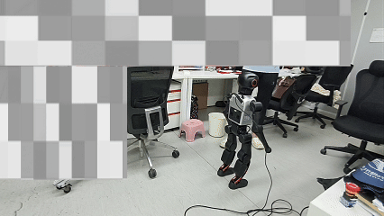
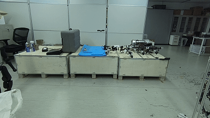

# booster_deploy_cpp

C++ 策略部署程序，将 mjlab 导出的 ONNX 运动策略部署到 Booster K1 机器人（或
`booster_mujoco` 仿真）上。框架借鉴 [go2_deploy](https://github.com/lupinjia/go2_deploy)，
推理使用 **onnxruntime C++ API**；并从 [booster_deploy](https://github.com/booster-robotics)
（Python 部署栈）借鉴了两个关键设计：

1. **从 ONNX metadata 读取部署参数**（`include/onnx_metadata.hpp`）：
   关节顺序、逐关节 PD 增益、默认位姿、action_scale、观测项/缩放/裁剪/历史长度等
   全部在运行时从模型的 `metadata_props` 自动解析，无需手工配置。
2. **ObservationManager 风格的观测构建器**（`include/observation_builder.hpp`）：
   按观测项名称注册实现，逐项执行 `compute -> clip -> scale -> history` 管道，
   历史采用 term-major 展平、首帧回填（与 mjlab CircularBuffer 行为一致）。

## 策略模型与部署效果

`models/` 下每个 ONNX 文件对应一种训练效果，**只需修改
`params/k1_config.yaml` 的 `policy_name` 指向不同模型即可切换**（控制周期、
观测/PD 参数等均由模型 metadata 自动解析，无需其他配置）：

| 模型文件 | 训练方式 | 部署效果 |
|----------|----------|----------|
| `k1_walk_vanilla.onnx` | 普通 RL（仅策略奖励） | 基础行走 |
| `k1_walk_amp.onnx` | RL + AMP（对抗运动先验） | 更自然的行走步态 |

实机部署效果：





## 架构

```
booster_deploy_cpp/
├── include/
│   ├── robot_controller.hpp      # 框架：DDS 通道 + 状态机 + 50Hz/500Hz 周期任务
│   ├── robot_interface.hpp       # 从 booster LowState 提取状态（关节/IMU/重力投影）
│   ├── user_controller.hpp       # BasicUserController 接口 + K1OnnxController（ORT 推理）
│   ├── onnx_metadata.hpp         # ONNX metadata 解析（booster_deploy/onnx_metadata.py 的 C++ 移植）
│   ├── observation_builder.hpp   # 观测构建器（observation_builder.py 的 C++ 移植）
│   ├── gamepad.hpp               # 手柄状态抽象（平滑/死区/按键边沿检测）
│   ├── local_joystick.hpp        # 真机模式：直接读本地 /dev/input/jsX 手柄设备
│   ├── periodic_task.hpp         # 周期任务封装（clock_nanosleep 绝对时间节拍，低抖动）
│   ├── data_logger.hpp           # DataTamer/MCAP 策略数据日志
│   ├── state_machine.hpp         # 状态机：DAMPING -> STAND -> CTRL
│   └── conversion.hpp            # 四元数/欧拉角/重力投影工具
├── src/main.cpp
├── params/k1_config.yaml         # 部署配置（dt/模型路径/PD 增益/DDS/手柄设备）
├── models/                       # ONNX 策略模型（见上方模型表）
├── third_party/onnxruntime/      # 本地化 onnxruntime C++ SDK（头文件 + lib）
└── tools/
    ├── virtual_remote.cpp        # 无手柄集成测试工具（仿真发布脚本化手柄状态）
    └── joystick_test.cpp         # 本地手柄设备值读取测试工具
```

## DDS 通信（与 booster_mujoco 对接）

| 方向 | Topic | 消息 | 说明 |
|------|-------|------|------|
| 订阅 | `rt/low_state` | `LowState` | 500Hz 机器人状态（关节 q/dq/tau + IMU） |
| 订阅 | `rt/remote_controller_state` | `RemoteControllerState` | 手柄状态（仅仿真模式订阅） |
| 发布 | `rt/joint_ctrl` | `LowCmd` | 500Hz 关节指令（PD 控制） |

## 构建

```bash
mkdir build && cd build
cmake .. -DCMAKE_BUILD_TYPE=Release
make -j$(nproc)
```

依赖：booster_robotics_sdk（静态库）、onnxruntime（已随项目附带）、yaml-cpp、spdlog。

## 运行

```bash
# DDS 需要加载 FastDDS 配置文件（与 booster_mujoco 一致）
export BOOSTER_FASTRTPS_DEFAULT_PROFILES_FILE=/path/to/booster_mujoco/fastdds_profile.xml

# 仿真联调（本地回环，domain 1，interface lo；手柄状态来自 DDS topic）
./build/booster_deploy_cpp

# 真机（domain 0，interface 由参数指定；直接读本地手柄设备 /dev/input/js0）
./build/booster_deploy_cpp lo
```

### 仿真 vs 真机的遥控器处理

| | 仿真（无参数） | 真机（带参数，argc >= 2） |
|---|---|---|
| 手柄来源 | 订阅 DDS `rt/remote_controller_state`（booster_mujoco 持续发布） | **直接读本地手柄设备**（`/dev/input/js0`，`joystick_device` 可配置） |
| 设备路径 | - | `/dev/input/js0` |
| 看门狗 | 无（不需要） | 无（不需要） |

**已移除遥控器看门狗**：早期版本通过 `remote_timeout_ms` 超时检测"遥控器静默"
来强制归零，因为实机遥控器只在操作时发布消息、回中/松手后不再发送，最后一条
命令值会残留。现在真机直接持有物理手柄设备，摇杆释放后由物理回中自然归零
（与 booster_deploy Python 版一致），不再依赖超时机制，故看门狗及其配置已删除。

### 真机运行要点（实机调试经验）

- **DDS 参数：domain_id = 0、interface = lo**。程序不带参数运行时走仿真约定
  （domain 1 + lo，手柄走 DDS）；带参数运行时走真机约定（domain 0 + 参数指定的
  网卡，手柄走本地设备直读）。
- **需要先进入 Custom 模式**：真机上 `rt/joint_ctrl` 命令只有在 Custom 模式下才生效。
  带参数运行（如 `./booster_deploy_cpp lo`）时程序会自动调用
  `B1LocoClient::ChangeMode(kCustom)` 切换；若失败会打印 `ChangeMode failed` 并退出。
- **手柄设备直读**：真机模式打开 `params/k1_config.yaml` 中 `joystick_device`
  指定的设备（默认 `/dev/input/js0`），以 100Hz 轮询并映射为与仿真相同的
  `RemoteControllerState` 语义。设备打开失败会报错退出；运行中设备拔出则保留
  最后已知状态（此时应立即停止操作并检查手柄连接）。
- **摇杆方向约定**：实机遥控器的 `ly` 方向与仿真相反，已在
  `GetInput`（`user_controller.hpp`）与仿真桥（`booster_mujoco` 的
  `fillRemoteControllerState`）中各取反一次，统一了 `RemoteControllerState.ly` 的协议约定。
- **验证手柄读取值**：真机运行前可用 `./build/joystick_test` 打印本地设备的
  原始轴值、归一化 lx/ly/rx/ry、按键与十字键状态，确认映射符合预期。

手柄操作（与 go2_deploy 一致）：

| 按键 | 功能 |
|------|------|
| START | 启动控制循环 |
| LB + RT | 站立 STAND |
| LB + A | 进入策略控制 CTRL |
| LB + Y | 停止（阻尼） |

左摇杆前后/左右控制 vx/vy，右摇杆控制 vyaw。

## 从 ONNX metadata 自动读取的参数

- `joint_names`：策略关节顺序（与真实机器人一致则无需重映射）
- `joint_stiffness` / `joint_damping`：CTRL 状态逐关节 PD 增益
- `default_joint_pos`：站立基准位姿（`stand_pos`）
- `action_scale`：动作缩放（逐关节）
- `observation_names` / `obs_scale.<term>` / `observation_terms_clip` /
  `observation_terms_history_length`：观测管道参数
- `actor_obs_dim` / `actor_history_length`：观测维度与历史帧数

`params/k1_config.yaml` 仅需提供模型路径（`policy_name`）、控制周期（`dt`）、
过渡 PD 增益、DDS 参数和真机手柄设备路径（`joystick_device`）。

## 集成测试（无手柄）

```bash
# 1. 启动仿真（K1）
cd booster_mujoco
export BOOSTER_FASTRTPS_DEFAULT_PROFILES_FILE=$PWD/fastdds_profile.xml
xvfb-run -a ./simulate/build/booster_mujoco -r k1

# 2. 启动部署程序
cd booster_deploy_cpp/build
./booster_deploy_cpp

# 3. 启动虚拟手柄（自动执行 START -> STAND -> CTRL -> 速度指令 -> STOP）
./virtual_remote lo
```

`virtual_remote` 发布脚本化的 RemoteControllerState 序列，用于端到端验证
状态机流转与策略推理。注意 DDS 发现需要数秒，请等待部署程序就绪后再操作。

## 注意

- 仿真中机器人从零位姿启动会自然倒下（与 unitree_mujoco 的 go2 行为一致），
  请在机器人站立时尽快进入 CTRL；倒地后安全回退（fall-safe）会自动切回阻尼状态。
- 手柄边缘检测在控制率（50Hz）下进行（`Gamepad::tick`），帧回调只刷新原始状态。
